# Architecture

The Mocha architecture contains two crossbars.<!-- ibyb3i_x -->
One crossbar is 64-bit width and is meant for the main memory.<!-- iiu1i5_x -->
The other crossbar is uncached and meant to contain the peripherals.<!-- e16ysv_x -->
Because most of these peripherals are imported from OpenTitan, in the first instance this bus is implemented as a TileLink Ultra-Lightweight bus with 32-bit width.<!-- ch8b58_x -->

<!-- m00a78_x -->

## Clock domains

There are three clock domains in Mocha.<!-- rfj4pd_x -->

1. Main: The main clock domain is the high-speed clock domain that runs the CVA6 core as well as the AXI crossbar it connects to, the AXI tag controller, debug module and the SRAM.<!-- yj8kx5_x -->
2. IO: The IO clock drives most of the peripherals and runs at a lower speed than the main clock.<!-- xe90jz_x -->
   It drives the TileLink bus and most of the peripherals that are connected to it like the UART and the SPI device.<!-- 4vkzbx_x -->
3. AON: The always on clock is also a low-speed clock with the difference being that it is always on.<!-- s61dxh_x -->
   Both the main and IO clocks can be disabled and are turned off when a system reset is requested.<!-- 68url6_x -->
   The always on clock drives the clock, reset and power managers and allows the system to come out of reset.<!-- w5ylk6_x -->

## Power sequencing

The power manager sequences the clocks and resets of Mocha's two power domains, `Aon` and `Main`, through cold boot and reset.<!-- edji36_x -->
It contains two state machines, a slow one on the always on clock and a fast one on the IO clock.<!-- fviuf3_x -->
The slow state machine drives the main domain power controls and the source clock enables towards the AST (Analog Sensor Top), but Mocha has no AST, so in practice it only starts the fast state machine after the power-on reset and then stays idle.<!-- bjwe3p_x -->
The fast state machine runs the rest of the power-up sequence, including the clock manager and reset manager handshakes.<!-- 1qitt6_x -->

Cold boot follows the vendored sequence, but most of the handshakes it waits on are tied off in Mocha.<!-- gqtuab_x -->

1. The slow state machine waits for the AST to report the main power as good and the clocks as valid. `pwr_ast_i` is tied to a default that reports both straight away and `pwr_ast_o` is left unconnected, so the main domain is always powered and never isolated.<!-- f1ik37_x -->
2. The slow state machine then requests the fast state machine to leave its low power state and start its part of the sequence. The fast state machine releases the main root clock and IO root clock gates in the clock manager and waits for the clock manager to report them released.<!-- uubyud_x -->
3. The fast state machine asks the reset manager to release the life cycle and system resets and waits for the life cycle reset to conclude, then waits for the OTP controller to finish sensing and the life cycle controller to decode the life cycle state before acknowledging the slow state machine's request. Mocha has neither `otp_ctrl` nor `lc_ctrl`, so `pwr_otp_i` and `pwr_lc_i` are tied to their done and idle defaults and neither step waits on another block.<!-- i3myfx_x -->
4. The fast state machine pulses `strap_o`, which tells the GPIO block to capture its input pins as boot straps for the rest of the system to read. Mocha instantiates the GPIO block with `GpioAsHwStrapsEn = 0`, which removes that capture logic, so the pulse is ignored and no straps are stored.<!-- psbuse_x -->
5. The fast state machine waits for the ROM controller to report its integrity check as `done` and `good`. Bypassing the integrity check needs both `lc_dft_en` and `lc_hw_debug_en` asserted, and Mocha ties `lc_dft_en_i` to `Off`, so the check cannot be skipped. `fetch_en_o` then releases the core and lifts the isolation in front of the ROM, so a failing check leaves the core held and the ROM contents unreachable.<!-- cbobz4_x -->

The power manager IP also supports low power entry and exit, but Mocha does not use them.<!-- q1rz33_x -->
To enter low power mode, software sets `CONTROL.LOW_POWER_HINT` and then executes a WFI, which the core reports to the power manager on `pwr_cpu_i`.<!-- 6lv64z_x -->
In Mocha `pwr_cpu_i` is tied to zero, so the power manager never sees the WFI, setting the hint has no effect and `low_power_o` is left unconnected.<!-- 1xp1ry_x -->
The [Mocha configuration](../../hw/top_chip/data/pwrmgr_cfg.hjson) declares a single wakeup source from low power, `ext_wkup_req`.<!-- d9esmg_x -->
In Mocha, `ext_wkup_req` is tied off at the instantiation, so the wakeup status and wakeup info never record a wakeup, and the wakeup interrupt never fires because low power is never entered.<!-- 7zmotv_x -->
The `CORE_CLK_EN`, `IO_CLK_EN` and `MAIN_PD_N` fields of `CONTROL` consequently have no effect either, and low power entry and exit are exercised only in the block-level testbench.<!-- hscs2u_x -->

The reset requests the power manager accepts are described under [reset domains](#reset-domains).<!-- cdyqu3_x -->
Of these, the main power supply glitch reset is raised by the power manager itself and cannot fire in Mocha because the AST tie-off reports the main power as always good.<!-- 3xnfam_x -->
The power manager also watches its escalation clock and requests an escalation reset if that clock stops toggling, but in Mocha that clock is the same IO clock that drives the check, so the timeout cannot fire.<!-- udig6x_x -->

The vendored [theory of operation](../../hw/top_chip/ip_autogen/pwrmgr/doc/theory_of_operation.md) describes the two state machines and the power-up and reset sequences correctly, but it is written for the OpenTitan configuration and differs from Mocha, mainly:<!-- lynxn6_x -->

1. It has AST power up the main domain and report power okay and clock valid, which Mocha ties off as described above.<!-- phfl3n_x -->
2. It relies on `otp_ctrl` and `lc_ctrl` for OTP sensing, life cycle initialisation and the ROM check bypass, which Mocha ties off as described above.<!-- 5scbe0_x -->
3. The flash handling sections describe `flash_ctrl` and a vendor flash macro, neither of which Mocha has, so `pwr_nvm_i` is tied to idle.<!-- vfatcx_x -->
4. It says the WFI indication is exported from Ibex as `core_sleeping_o`. Mocha uses CVA6-CHERI and ties `pwr_cpu_i` off as described above.<!-- t1szt2_x -->
5. It says a non-debug-module reset leaves the debug module state and the TAP muxing inside the pinmux untouched. Mocha has no pinmux, and how the debug module stays out of reset is described under [reset domains](#reset-domains).<!-- c22rd1_x -->

## Memory map

This is the current memory map for Mocha, where the base and top addresses are inclusive, and reserved is the amount of memory reserved for this function:<!-- mcbp27_x -->

<!-- BEGIN generated memory map -->
| Base address | Top address | Reserved   | Function      |
|--------------|-------------|------------|---------------|
| 0x00080000   | 0x00087fff  | 32.0 kiB   | ROM           |<!-- tm13gh_x -->
| 0x10000000   | 0x1001ffff  | 128.0 kiB  | SRAM          |<!-- lhfz6r -->
| 0x20000000   | 0x2000ffff  | 64.0 kiB   | DEBUG_MODULE  |<!-- sgfpp0_x -->
| 0x20010000   | 0x2001ffff  | 64.0 kiB   | MAILBOX       |<!-- z1bwrt_x -->
| 0x20020000   | 0x2002ffff  | 64.0 kiB   | DV_SW_IFC     |<!-- u122px_x -->
| 0x30000000   | 0x30007fff  | 32.0 kiB   | ETHERNET      |<!-- 2z3zns_x -->
| 0x40000000   | 0x4000ffff  | 64.0 kiB   | GPIO          |<!-- l5wm3d_x -->
| 0x40020000   | 0x4002ffff  | 64.0 kiB   | CLKMGR        |<!-- zuyj1v_x -->
| 0x40030000   | 0x4003ffff  | 64.0 kiB   | RSTMGR        |<!-- n2dywn_x -->
| 0x40040000   | 0x4004ffff  | 64.0 kiB   | POWER_MANAGER |<!-- vtnnyw_x -->
| 0x40050000   | 0x4005ffff  | 64.0 kiB   | ROM_CTRL      |<!-- ov4jpa_x -->
| 0x40060000   | 0x4006ffff  | 64.0 kiB   | ENTROPY_SRC   |<!-- s8gkf4_x -->
| 0x41000000   | 0x4100ffff  | 64.0 kiB   | UART          |<!-- heoi9y_x -->
| 0x42000000   | 0x4200ffff  | 64.0 kiB   | I2C           |<!-- 94u3qu_x -->
| 0x43000000   | 0x4300ffff  | 64.0 kiB   | SPI_DEVICE    |<!-- vniczf_x -->
| 0x44000000   | 0x4400ffff  | 64.0 kiB   | TIMER         |<!-- gjk3vu_x -->
| 0x45000000   | 0x4500ffff  | 64.0 kiB   | SPI_HOST      |<!-- jkyz51_x -->
| 0x48000000   | 0x4c004003  | 64.0 MiB   | PLIC          |<!-- pfftm1_x -->
| 0x80000000   | 0xbf7fffff  | 1016.0 MiB | DRAM          |<!-- 04smz7_x -->
<!-- END generated memory map -->

## Top-level interface

The Mocha top will need a few top-level inputs.<!-- i7mqt7_x -->
Some of these are listed here:<!-- 1cwb13_x -->
- Clock outputs from PLLs.<!-- p4bt5a_x -->
- Rollback counter backed by OTP.<!-- 7215fb_x -->
- Debug and design for test enable pins.<!-- 5fh61t_x -->
- True random noise source to drive the entropy source.<!-- 8u3w8m_x -->
- AXI subordinate port to connect to the mailbox.<!-- fna4to_x -->

In terms of output, the top-level will need output signals:<!-- tvdygx_x -->
- Key to provide an AES engine outside of the secure enclave with the memory encryption key.<!-- fv7l7k_x -->
- AXI manager port to interact with the rest of the chip.<!-- du1glx_x -->

## CVA6-CHERI

Mocha will instantiate CVA6-CHERI.
This is specified in [cva6-cheri.md][cva6-cheri-spec].

## SRAM specification

The static random-access memory (SRAM) in CHERI Mocha is mainly used as the stack and heap for the boot firmware that lives in the read-only memory (ROM).<!-- 21k32t_x -->
However, it should also be possible to execute from SRAM.<!-- lhjkel -->
Once code starts executing from dynamic random-access memory (DRAM), we don't envision using SRAM anymore.<!-- a3l94p_x -->

The SRAM block has four ports:<!-- qohtih -->
- Clock input<!-- 947rwh -->
- Reset input<!-- rrni5j -->
- AXI4 request input from the main SoC sub-system crossbar<!-- pgo845 -->
- AXI4 response output back to the main crossbar<!-- n5txiq -->

Inside the block it translates the AXI4 requests into an SRAM interface that our primitive RAM wrappers use.<!-- vknoin -->
It needs to support AXI4 protocol including:<!-- mcykq8 -->
- Bursts, where the last signal must be indicated correctly.<!-- o02amt -->
- Response must have the same AXI4 ID as the request<!-- 4t4cew -->
- Atomic support is *excluded*. An atomic accesses should return an error.<!-- bsi4rc -->
- The data width is 64 bits.<!-- jeluga -->
- The address range and size of the SRAM are defined in the [memory map](#memory-map). For accesses outside this range, the xbar must return a decode error (DECERR), including if only part of the burst is outside the memory range.<!-- u0s8nt -->
- Responses must return within a bounded amount of time that may be proportional to the length of the burst.<!-- 34ld5i -->
- Only aligned 64-bit accesses are allowed.<!-- lfcb7q -->

There needs to be 1 CHERI tag bit per 128-bit aligned region.<!-- 01skcc -->
A tag should only be set to 1 by writing a full 128-bit aligned region.<!-- 8rlwol -->
This 128-bit aligned transaction must be part of a single burst.<!-- 35vdeg -->
The CHERI tag bits are communicated through a single user bit per AXI4 flit (`wuser` and `ruser` for writes and reads respectively).<!-- u95b14 -->
There should be an assertion to notify when writes occur where `wuser` is set to 1 which is not part of a full capability write.<!-- bj8we7 -->
There should also be an assertion for `wuser` mismatches, where one part of the capability is marked as valid while another is invalid in the same transaction.<!-- 9a3xf6 -->
If a portion of the 128-bit aligned region is written it must clear the tag for the whole region including when a partial write strobe is used.<!-- 893tz4 -->

Reads that only read part of a 64-bit value are allowed from valid capability regions, but these reads should have their tag cleared in the response.<!-- raa5pw -->
These reads do not modify the state of the tag in memory.<!-- 832lpx -->
Burst reads from the SRAM must have the appropriate CHERI tags set for each address, so a valid capability must have the user bits set for both of the 64-bit flits it is being sent back, and a mixture of capability and non-capability data is allowed in a burst.<!-- kn6exz -->
The SRAM is allowed to mark a capability as invalid by setting one or both of the `ruser` bits to zero, so the core must AND the two `ruser` values together to determine the validity of a capability.<!-- af8sx6 -->
Tags should be stored in a separate block of memory from the data, this is to allow future optimisations where bulk-reads of tags are desired.<!-- lzoy40 -->

The initial value of the SRAM including the tags is undefined at start-up.<!-- hqbiau -->

[cva6-cheri-spec]: ./cva6-cheri.md
